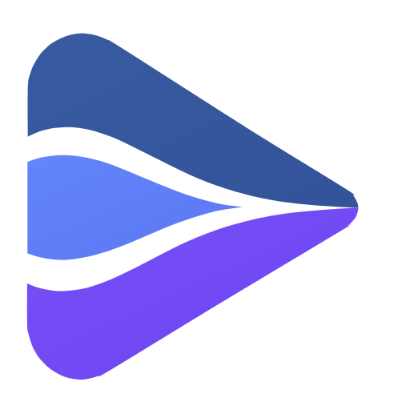

<div align="center">
  
  <h1>MuxShift</h1>
  <p>Several media sources in one session: a scene picks what is seen and heard, and one event timeline aligns them</p>
  <p>
    <a href="README.md">中文</a> ·
    <a href="https://github.com/xswt442-cmd/muxshift/releases">Download</a> ·
    <a href="CHANGELOG.md">Changelog</a> ·
    <a href="docs/development/RELEASE.en.md">Release process</a>
  </p>
  <p>
    <a href="https://github.com/xswt442-cmd/muxshift/actions/workflows/ci.yml"></a>
    <a href="https://github.com/xswt442-cmd/muxshift/releases"></a>
    <a href="LICENSE"></a>
    <a href="go.mod"></a>
  </p>
</div>

An early prototype: it attaches sources, switches between them, aligns them by
hand, and lands on a position inside a replay. Capture, mixing and automatic
cross-source sync are not built.

## Download

[Releases](https://github.com/xswt442-cmd/muxshift/releases) ship a Windows amd64
ZIP (`muxshift-0.0.1-windows-amd64.zip`); unzip it and run `muxshift.exe`. It
needs Windows 10/11 and the Media Foundation that ships with it. The archive
carries `VERSION.txt`, `THIRD-PARTY.md` and the checksum; building from source is
under [quick start](#quick-start).

## What works

- **One Core session**: sources, tracks, sync groups, scenes, outputs, and an
  event timeline — shared event time plus a track's own offset is the media time
  that track should play.
- **HLS intake**: reads the playlist and probes tracks and the first sample
  time. Cross-stream alignment needs a program date time; without one it refuses
  rather than guesses.
- **Desktop app**: a native MyGo window plays several sources, scenes choose
  picture and sound, each source has its own volume; manual nudges of ±0.1 s,
  and the automatic alignment only ever suggests, it never writes the timeline.
  The left rail holds scenes only, the canvas carries a compact icon cluster,
  and the console under it shows Sources / Mixer / Sync side by side: draggable,
  foldable, each panel hideable, three tabs in a narrow window; the one-row-per-
  source layout is a setting.
- **Watching modes**: besides editing, the scene can be watched in cinema
- **Five stage layouts**: Focus watches one picture, Split puts two side by side, PiP fills the stage and keeps a second picture in the lower right corner, Grid is 2×2, Hero is a wide main picture with the rest stacked on the right. Switching a layout only moves pictures; players, sound and sync are untouched. A source that does not fit is taken off the stage instead of covering it, and a slot whose first frame has not arrived says "waiting for the first picture".
- **A stage you can arrange (OBS-style transforms)**: in editing mode a picture can be dragged, resized from eight handles, locked to its aspect ratio, placed by typing exact numbers, nudged with the arrow keys, and raised or lowered in the stacking order. Editing applies only while editing, so watching cannot move a picture by accident. Positions are stored as fractions of the stage, so resizing the window or changing display scaling keeps the arrangement.
  (window frame kept, editing chrome hidden), full screen with F11, or a small
  always-on-top window. Moving between the four never reopens a player or jumps
  the clock, and leaving one restores the old window bounds, maximized state and
  open panes. The floating bar hides after 2.5 s of no input but stays while the
  pointer or the keyboard focus is on it; F11, Esc, a double click, Tab, Space
  and the arrow keys reach the same places.
- **DVR buffer**: live segments are kept in a bounded directory, the really
  available range and its gaps are reported, and one continuous span is cut into
  a recording; a switch puts the new player's picture up before replacing the
  source, and rolls back when it cannot.
- **Seeking inside a replay**: once a stage is replaying, its inspector can ask
  for one position inside the candidate common window; each source is authorized
  separately, out-of-window and concurrent requests are refused, and a failed
  commit rolls back entirely.
- **Web client and extension**: the web client binds to loopback only, plays
  with hls.js and can switch scenes; the extension hands the one address the
  user picked to the local session, never cookies, headers or keys.

## Quick start

Go 1.27 or newer.

```sh
go test ./...
cd desktop && go test ./...
```

Desktop app (Windows, opens a real window):

```sh
cd desktop
go build .
./desktop.exe -media <local file or http(s) URL> [-media <second source> ...]
```

Web client:

```sh
go run ./web -media-root <media dir> \
  -media /media/hls-vod/index.m3u8 -media /media/hls-vod/second.m3u8
```

It prints a `http://127.0.0.1:<port>/?token=<token>` URL; the token appears
once, the page trades it for an HttpOnly cookie and removes it from the address
bar.

## Adding a source

The top bar's `Open…` and the Sources page's `Add…` open the same panel, which
offers three choices:

- **Local file** opens the system file picker; the chosen file joins the current
  session, and cancelling changes nothing.
- **Media link** takes an http(s) HLS playlist or a directly readable media file.
  The desktop reads what the address actually serves rather than trusting its
  extension, so a web page, a 404 or an unsupported type is refused with a
  reason and never leaves an empty card behind.
- **Website address** opens the page in the system browser. For the page's own
  address to reach the desktop, load the `extension/` (unpacked; no Native Host
  any more): take the one-time pairing code from the Diagnostics page, paste it
  into the extension popup once, then pick the address the page loaded and hand
  it to this window.
- **Live streams** on Bilibili, Twitch and Kick pages, and on YouTube live
  pages, give the popup one more button, `Use this live stream`. The address is
  exchanged inside the page's own session (Bilibili's `platform=h5` m3u8,
  Twitch's playback token, the playback address in Kick's channel answer, the
  page's own `hlsManifestUrl` on YouTube); the desktop receives a signed URL and
  no cookie. Each site is one entry in a table that says which page it answers
  for, which endpoint it asks, and which field holds the address; the shared
  part — the request, the first mirror that answers, the HLS test, the wording —
  exists once, so adding a site means adding one entry. The desktop then reads
  the playlist itself: a master playlist contributes one variant, a stream with
  `#EXT-X-KEY` is refused with the method it names, and a stream without
  `#EXT-X-ENDLIST` is opened as live and starts on its own — no Play needed.

Whether a page can hand anything over is up to the page: `blob:`/MSE players,
pages that need a login or DRM, and cross-origin restrictions are not worked
around, only explained. Only http(s) addresses are accepted; no cookies, request
headers or keys are passed on. Twitch's token is therefore anonymous: that site
refuses a credentialed cross-origin request, so a public channel plays while one
that needs a subscription or a region is refused honestly.

## Documentation

| Document | Contents |
| --- | --- |
| [Architecture](docs/development/ARCHITECTURE.en.md) | Module boundaries, data flow, the replay clock contract and known limits |
| [Verification index](docs/development/VERIFICATION.md) | What each check covers, and what only a real window can show |
| [Changelog](CHANGELOG.md) | What each version added, improved and fixed |
| [Release process](docs/development/RELEASE.en.md) | Maintainers: version, tag, build verification and publishing |

## Limits

- **Entering a replay from live is not offered**: there is no toolbar button and
  no shortcut. The internal planning and transaction code exists, but a test
  keeps it out of the shipped paths.
- **Cross-source content correspondence is experimental**: V1 was rejected for
  authorizing use and V2 is recorded as ObservedSupport only; neither is on the
  playback path and neither writes the timeline.
- **"Position settled" is not "frame presented"**: a committed seek only proves
  the players reported the position they were asked for, and the account keeps
  saying `position settled, the frame is not confirmed`.
- The desktop app only advances the source it is drawing: switch to another page
  and the stage stops; come back and it catches up after a few seconds.
- A first seek at the very edge of a recording can fail intermittently and roll
  back safely; the rate has not been measured. The web client does not do
  alignment or replay, and its seeks stay inside what the browser buffered.
- A source imported while running joins playback once its player shows a
  picture; a bad address only reports an error and leaves no empty card.
- **Video sites are still not a supported feature**: the extension hands over an
  http(s) media address the page already loads, plus the address the four live
  pages exchange. On-demand pages that feed segments to MSE (Bilibili and the
  like) expose no single replayable address, and the YouTube sample asks for a
  login; both get a clear message, and nothing bypasses the login, cross-origin
  rules or DRM. YouTube live does yield an `hlsManifestUrl`, but the `/ip/<exit>/`
  inside it is tied to the exit that asked for it: on this machine the playlist
  reads and the media segments are refused by the edge (`403`), so it does not
  reach a picture on this path, and both the extension and the desktop say so
  instead of pretending to play.
- **Live plays only what is happening now**: no replay buffer and no
  cross-source alignment; the shared clock starts with the picture, and an
  address that expires has to be fetched again from the extension.
- **Machines behind a proxy**: the desktop reads `HTTP_PROXY`/`HTTPS_PROXY`
  first, then the Windows Internet Settings proxy, and always connects to
  loopback directly.

## Layout

| Path | Contents |
| --- | --- |
| `core/` | session model, event timeline, HLS intake and DVR buffer |
| `desktop/` | MyGo desktop app and scripted checks |
| `web/`, `extension/` | loopback web session and browser extension (no native host) |
| `tools/` | separation, alignment and design tokens |
| `docs/development/` | architecture, verification index, release process |

## License

MIT, see [LICENSE](LICENSE).
