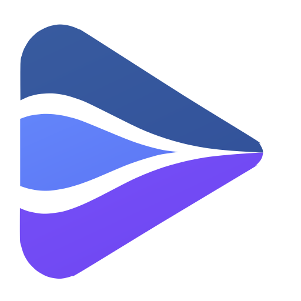

<div align="center">
  
  <h1>MuxShift</h1>
  <p>Compose several audio/video sources and control their timeline</p>
  <p>
    <a href="README.md">简体中文</a> ·
    <a href="docs/development/ARCHITECTURE.en.md">Architecture</a> ·
    <a href="desktop/scenarios.go">Scenarios</a>
  </p>
  <p>
    <a href="https://github.com/xswt442-cmd/muxshift/actions/workflows/ci.yml"></a>
    <a href="LICENSE"></a>
    <a href="go.mod"></a>
    
  </p>
</div>

Several media sources in one session, a scene that decides which picture is shown and which sounds are heard, and a timeline that lines them up.

It is early: sources attach, scenes switch, offsets can be aligned, a short window can be replayed. Capture, mixing and automatic cross-source sync are not built.

## What it does

- **One Core session**: sources, tracks, sync groups, scenes, outputs, and an event timeline where shared event time plus a track's own offset gives the media time that track should play.
- **HLS ingest**: reads playlists, tracks and first sample times. Cross-stream alignment needs PDT; without it the answer is a refusal, not a guess.
- **Desktop**: MyGo's native window plays several sources, the scene picks picture and sound, each track has its own volume, manual alignment moves in 0.1 s steps, and the automatic probe only suggests, it never writes the timeline.
- **Replay buffer**: live segments land in a bounded directory, the window reports what is really replayable and where the gaps are, and a contiguous range becomes a recording file. A switch shows the new player before replacing the old one and rolls back if it never does.
- **Web client**: one loopback-only Go process serves a page that plays through hls.js and can switch scenes and read the event log.
- **Extension**: hands the one address the user picked to the local session, without cookies, request headers or secrets.

## Quick start

Go 1.27 or newer.

```sh
go test ./...
cd desktop && go test ./...
```

What each check covers, and what only runs in a real window, is in the [verification index](docs/development/VERIFICATION.md).

Desktop (Windows, opens a real window):

```sh
cd desktop
go build .
./desktop.exe -media <local file or http(s) address> [-media <second source> ...]
```

Web client:

```sh
go run ./web -media-root testplace/media \
  -media /media/hls-vod/index.m3u8 -media /media/hls-sync-a/index.m3u8
```

It prints `http://127.0.0.1:<port>/?token=<token>`. The token appears once, the page swaps it for an HttpOnly cookie and removes it from the address bar.

## Limits

- A source can be imported while the session runs: its card appears and the player comes up with a picture; an address that cannot be read reports an error and leaves no empty card.
- Replay stops at "switch to a recording": the switch shows the new player's picture before it takes the stage and rolls back on failure; treating a replay window as an authorized seek range is not done yet.
- The desktop only advances the picture it is drawing: another page stalls the stage, and returning catches up within seconds.
- Audio separation and content matching are experiments outside the playback path and never move the timeline.
- The web client neither aligns sources nor keeps history; seeking stays inside what the browser has buffered.
- The video path of the automatic probe is implemented but was not validated on real footage; the audio path has measurements, in [tools/align](tools/align/README.md).

## Layout

| Path | Contents |
| --- | --- |
| `core/` | session model and event timeline |
| `core/hls/` | playlist reading and probing |
| `core/dvr/` | replay buffer, gaps and recording joins |
| `desktop/` | MyGo desktop app and scenario scripts |
| `web/` | loopback session service and page |
| `extension/` | extension and native host |
| `tools/` | separation, alignment, design tokens |
| `docs/development/` | architecture and engineering standards |

Module status and dependency direction are in the [architecture](docs/development/ARCHITECTURE.en.md), together with the web client's token, origin and path rules.

## License

MIT, see [LICENSE](LICENSE).
