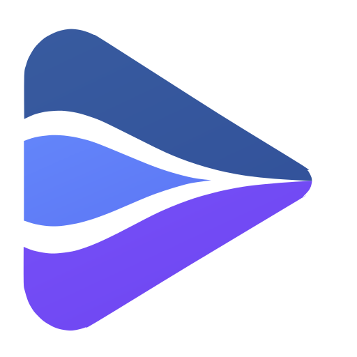

<div align="center">
  
  <h1>MuxShift</h1>
  <p>多路音视频组合与时间轴控制</p>
  <p>
    <a href="README.en.md">English</a> ·
    <a href="docs/development/ARCHITECTURE.zh-CN.md">架构</a> ·
    <a href="docs/development/VERIFICATION.md">验证索引</a>
  </p>
  <p>
    <a href="https://github.com/xswt442-cmd/muxshift/actions/workflows/ci.yml"></a>
    <a href="LICENSE"></a>
    <a href="go.mod"></a>
    <a href="VERSION"></a>
  </p>
</div>

把多路媒体源放进同一个会话，由场景决定看哪一路画面、听哪几路声音，并在事件时间轴上对齐它们。

早期原型，不是成品：能接入、能切换、能对轴、能切录像并在已经回放的舞台上定位。采集、混音、跨源自动同步没有做。

## 功能

- **一个 Core 会话**：源、轨道、同步组、场景、输出，加一条事件时间轴——共享事件时间加上每条轨道自己的偏移，就是这条轨道该播的媒体时间。
- **接入 HLS**：读播放列表、探测轨道与首个样本时间。有 PDT 才能跨流对齐，没有就明确拒绝，不猜。
- **桌面端**：MyGo 原生窗口播放多路源，场景切画面与声音，每路独立音量；手动对轴 ±0.1 秒，自动对轴只给建议、不写时间轴。
- **回看缓冲**：直播分片存进有界目录，报告真实可回看区间与缺口，把一段连续区间切成录像；切换先把新播放器播出画面、再换源，失败回滚。
- **在回放里定位**：已经进入回放的舞台可以在 inspector 里按「共同窗口内第几秒」请求一次 Seek；逐源授权，越界与并发都明确拒绝，提交失败整体回滚。
- **Web 端与扩展**：Web 端只绑定回环地址、用 hls.js 播放、能切场景；扩展把用户点选的那一个地址交给本机会话，不传 Cookie、请求头或密钥。

## 快速开始

需要 Go 1.27 或更新版本。

```sh
go test ./...
cd desktop && go test ./...
```

哪些检查覆盖了什么、哪些只能在真窗口里跑，见[验证索引](docs/development/VERIFICATION.md)。

桌面端（Windows，会打开真实窗口）：

```sh
cd desktop
go build .
./desktop.exe -media <本地文件或 http(s) 地址> [-media <第二路> ...]
```

Web 端：

```sh
go run ./web -media-root <媒体目录> \
  -media /media/hls-vod/index.m3u8 -media /media/hls-vod/second.m3u8
```

它会打印一个带令牌的 `http://127.0.0.1:<端口>/?token=<令牌>`；令牌只出现这一次，页面立刻把它换成 HttpOnly cookie 并从地址栏移除。

## 发布

当前版本 **v0.0.1**：Windows amd64 ZIP，从干净提交构建，带 `VERSION.txt`、`THIRD-PARTY.md` 与可复现的 sha256。构建、校验、打标签与发布步骤见[发版流程](docs/development/RELEASING.md)。发行说明只列经过验证的能力，不提前承诺路线。

## 边界

- 运行中也能导入源：卡片出现后播放器随即出画，失败的地址只报错、不留下空卡片。
- **从直播进入回放不提供**：没有工具栏按钮，也没有快捷键。内部规划与事务代码存在，但由测试守着，出货文件里没有调用点。
- **跨源内容对应只是实验**：V1 已被判定不能用于授权，V2 仅记录为 ObservedSupport；它们不在播放路径上，也不会自己改时间轴。
- **「位置已落定」不等于「目标帧已呈现」**：Seek 提交只证明播放器报告了请求的位置，账户文案保持 `position settled, the frame is not confirmed`。
- 桌面端只推进正在被绘制的那一路：切到别的页面，舞台会停，切回来几秒后追上。
- 回看边界的首次定位可能间歇失败并安全回滚，频率尚未量化；Web 端不做对轴与回看，Seek 只落在浏览器已缓冲的范围。

## 目录

| 路径 | 内容 |
| --- | --- |
| `core/` | 会话模型、事件时间轴 |
| `core/hls/` | 播放列表读取与探轨 |
| `core/dvr/` | 回看缓冲、缺口与录像拼接 |
| `desktop/` | MyGo 桌面端与场景脚本 |
| `web/` | 回环会话服务与页面 |
| `extension/` | 扩展与 Native Host |
| `tools/` | 分离、对轴与设计令牌生成 |
| `docs/development/` | 架构、验证索引与发版流程 |

各模块的状态与依赖方向见[架构说明](docs/development/ARCHITECTURE.zh-CN.md)，Web 的令牌、同源与路径限制也在那里。

## 许可证

MIT，见 [LICENSE](LICENSE)。
