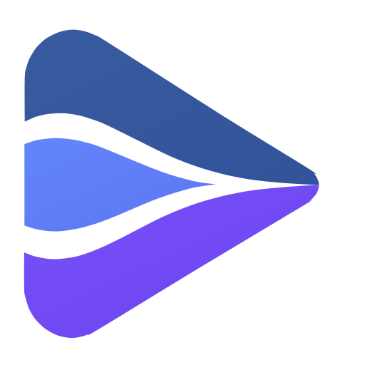

<div align="center">
  
  <h1>MuxShift</h1>
  <p>把多路音视频放进同一个会话，由场景决定看哪路、听哪路，并在事件时间轴上对齐它们</p>
  <p>
    <a href="README.en.md">English</a> ·
    <a href="https://github.com/xswt442-cmd/muxshift/releases">下载</a> ·
    <a href="CHANGELOG.md">更新记录</a>
  </p>
  <p>
    <a href="https://github.com/xswt442-cmd/muxshift/actions/workflows/ci.yml"></a>
    <a href="https://github.com/xswt442-cmd/muxshift/releases"></a>
    <a href="LICENSE"></a>
    <a href="go.mod"></a>
  </p>
</div>

## 下载

[Releases](https://github.com/xswt442-cmd/muxshift/releases) 提供 Windows amd64 ZIP（`muxshift-0.0.2-windows-amd64.zip`），解压后运行 `muxshift.exe`。需要 Windows 10/11 和系统自带的 Media Foundation。包里还有 `VERSION.txt`、`THIRD-PARTY.md` 和校验值。从源码构建见[快速开始](#快速开始)。

## 能做什么

- **一个会话放多路源**：每路源有自己的音视频轨，场景决定显示哪路画面、播放哪路声音，音量各自调整。
- **手动对轴**：用 ±0.1 秒把两路对到一起。播放列表带 PDT 时还能得到跨源建议，自动结果只给建议，不会改时间轴。
- **回看直播**：直播分片保留在有限目录里，可以查看还剩哪些区间，并把其中一段切成录像单独播放。
- **回放里跳转**：已经进入回放的舞台，可以按共同窗口内的秒数请求一次跳转；每一路单独授权，越界或前一次还没完成时会被拒绝。
- **五种画面布局**：Focus 单路、Split 左右、PiP 画中画、Grid 2×2、Hero 主画面加侧栏。
- **自由摆放画面**：编辑状态下可以拖动、缩放、锁定比例、填精确的数值，并调整画面的叠放顺序。位置按舞台比例保存，改窗口大小不会跑位。
- **四种观看方式**：编辑、影院、F11 全屏、置顶小窗，切换时不会重新加载播放器。
- **外观**：五套配色、三档字号、字体、界面语言和更紧凑的间距，在设置里选，选择立即预览。
- **Web 端**：只绑定本机回环地址，用 hls.js 播放，可以切换场景。
- **浏览器扩展**：把页面里已经加载的媒体地址交给桌面端，不传 Cookie、请求头或密钥。

## 快速开始

需要 Go 1.27 或更新版本。

```sh
go test ./...
cd desktop && go test ./...
```

桌面端（Windows，会打开真实窗口）：

```sh
cd desktop
go build .
./desktop.exe -media <本地文件或 http(s) 地址> [-media <第二路> ...]
```

Web 端：

```sh
go run ./web -media-root <媒体目录> \
  -media /media/hls-vod/index.m3u8 -media /media/hls-vod/second.m3u8
```

它会打印一个带令牌的 `http://127.0.0.1:<端口>/?token=<令牌>`；令牌只出现这一次，页面立刻换成 HttpOnly cookie 并从地址栏移除。

走代理的机器：桌面端先读 `HTTP_PROXY`/`HTTPS_PROXY`，没有就沿用 Windows「Internet 选项」里的设置，本机回环地址始终直连。

## 添加来源

`+ 来源` 打开添加面板，三选一：

- **本地文件**：系统文件选择器，选中后加入当前会话，取消不改变任何东西。
- **媒体链接**：http(s) 的 HLS 播放列表或可直接读取的媒体文件。桌面端按内容而不是扩展名判断，网页、404 和不支持的类型都会报错。
- **网站地址**：用系统浏览器打开页面。要让页面里的地址进入桌面端，需要加载 `extension/` 里的扩展（解压加载，不需要 Native Host）：在诊断页取一次性配对码，粘贴到扩展弹窗，之后选中页面已加载的那一条地址。

B 站、Twitch、Kick 和 YouTube 的直播页，扩展弹窗会多出 `Use this live stream`。桌面端拿到的是一条签名地址，不带 Cookie；带 `#EXT-X-KEY` 的加密流会被拒绝，没有 `#EXT-X-ENDLIST` 的按直播打开并自动播放。

能不能交出地址取决于页面：`blob:`/MSE、需要登录或 DRM、跨源受限的页面不会被绕过，只会给出说明。只接收 http(s) 地址，不传 Cookie、请求头或密钥。

## 文档

| 文档 | 内容 |
| --- | --- |
| [架构](docs/development/ARCHITECTURE.zh-CN.md) | 模块边界、数据流、回放时钟契约与已知限制 |
| [验证索引](docs/development/VERIFICATION.md) | 哪些检查覆盖了什么、哪些只能在真窗口里跑 |
| [更新记录](CHANGELOG.md) | 每个版本新增、改进、修复了什么 |
| [发版流程](docs/development/RELEASE.md) | 维护者：版本、标签、构建校验与发布步骤 |

## 已知限制

- **不支持从直播进入回放**：界面里没有入口。
- **不做采集、混音和跨源自动同步**：只播放给定的地址。不录制屏幕或设备，不混音，也不自动对齐多个来源。
- **视频网站只有那四种直播页可用**：B 站这类把分片交给 MSE 的点播页拿不到单个可重放的地址，YouTube 的点播未登录时会要求登录。YouTube 直播的地址绑着取地址时的出口 IP，播放列表能读，媒体分片可能被拒（403），这些情况只给提示，不绕过登录、跨源规则或 DRM。
- **直播只播当下，Web 端能力更少**：直播没有回看缓冲，也不做跨源对齐，签名地址过期后要从扩展重新取。Web 端不参与对轴，不保留历史，Seek 只能落在浏览器已缓冲的范围。
- **桌面端只推进正在显示的那一路**：切到别的页面舞台会停，切回来几秒后追上。
- **回看边界的第一跳可能失败**：刚进入回放时跳到缓冲区最边缘的位置会间歇失败，失败后保持原来的画面，发生频率还没统计。

## 目录

| 路径 | 内容 |
| --- | --- |
| `core/` | 会话模型、事件时间轴、HLS 与回看缓冲 |
| `desktop/` | MyGo 桌面端与场景脚本 |
| `web/`、`extension/` | 回环 Web 会话与浏览器扩展（无需 Native Host） |
| `tools/` | 分离、对轴与设计令牌生成 |
| `docs/development/` | 架构、验证索引、发版流程 |

## 许可证

[MIT](LICENSE)。
